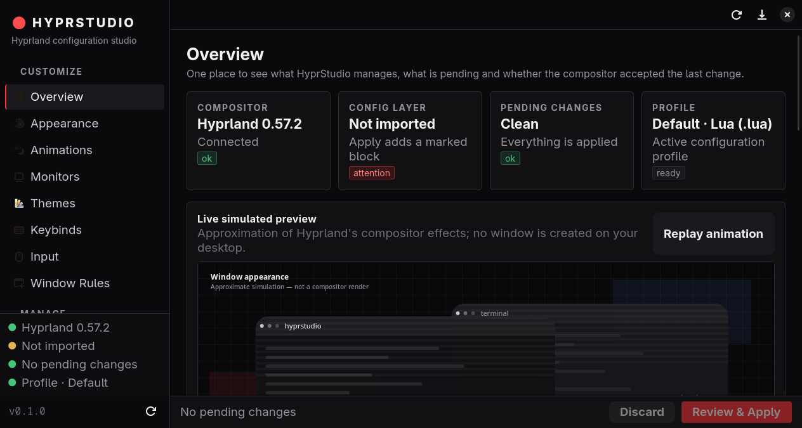
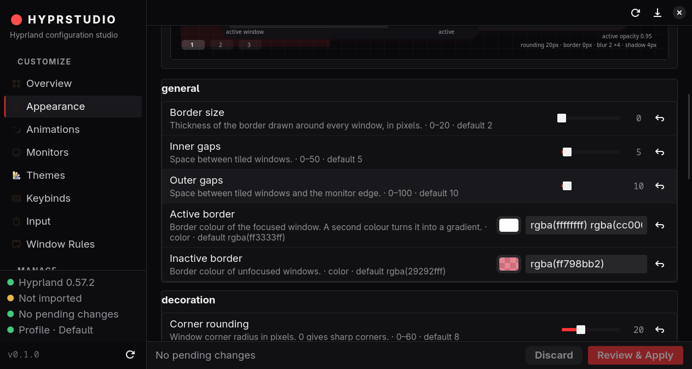

# HyprStudio

A native desktop studio for [Hyprland](https://hyprland.org): inspect the values you actually run, change appearance, animations, monitors, themes, keybinds, input and window rules visually, preview the result, and apply it through a transactional, backed-up write.

HyprStudio is **Rust + GTK4 + libadwaita**. There is no web view, no Electron and no Tauri shell.





## What it does

- **Overview** — compositor connection, configuration dialect, integration state, pending changes, conflicts and the last apply report (with per-option verification).
- **Appearance** — gaps, borders, rounding, active/inactive opacity, blur, shadows, dim, colour gradients, with a live simulated preview.
- **Animations** — Bézier/spring curves with a draggable editor, per-event durations and styles, animation presets, live replay.
- **Monitors** — per-output enable, mode, position, scale, rotation, VRR and mirror, plus a layout map and validation for overlaps/unsupported modes. Monitor profiles can be saved and loaded.
- **Themes** — five built-in, validated themes plus your own, shown as rendered swatches; loaded sparsely (only the modules present).
- **Keybinds** — validated dispatcher registry, flags, submaps for hyprlang, conflict detection against both HyprStudio's binds and `hyprctl binds`.
- **Input** — global input settings and per-device overrides (sensitivity, scroll factor, natural scroll, tap-to-click, disable-while-typing).
- **Window Rules** — regex match conditions and effects (float, opacity, workspace, size, centre, pin, fullscreen, border), with validation.
- **Presets** — capture, import, export and manage versioned TOML presets.
- **History** — snapshots before every apply, restore with a safety snapshot, and a change log.
- **Settings** — retention, notifications, UI scale, paths, capability diagnostics and documented limitations.

## Safety model

HyprStudio is designed to be boring about your configuration:

1. **Your files are never rewritten.** Managed output lives in `~/.config/hypr/hyprstudio/` as one file per module. The only change ever made to your own configuration is a clearly marked import block, appended only after you tick the checkbox in the review dialog.
2. **Nothing is written without a snapshot.** Every apply captures a backup first; a failure after writing restores it automatically and reports whether recovery succeeded.
3. **Files are validated before writing.** Values are range-checked, keybinds and rules are validated against the dispatcher/effect registry, and the rendered tree is checked with `hyprland --verify-config` in a throwaway directory (skippable only for tests via `HYPRSTUDIO_SKIP_HYPRLAND_VERIFY=1`).
4. **Written is not applied.** After `hyprctl reload`, HyprStudio queries the effective values back with `hyprctl getoption` and only says "Applied and verified" when they match. Otherwise it says "Written, not active" or "Applied with warnings" and lists what disagreed.
5. **External edits are visible.** Hashes of managed files are stored; if they change outside HyprStudio, the Overview warns before an apply would overwrite them.
6. **Presets are data, never code.** Strict TOML schema, unknown fields denied, size-limited imports, no execution of any kind.

## Requirements

- Hyprland (tested on **0.57.2**; options newer than your build are marked unavailable rather than written)
- Rust **1.85+** (tested with 1.99.1)
- GTK **4.16+** and libadwaita **1.6+** development packages
- SQLite is compiled in (`rusqlite` with bundled SQLite); no separate package needed
- `hyprland` in `PATH` for `--verify-config` (optional; without it the pre-write verification step is skipped and reported)

On Arch/CachyOS:

```bash
sudo pacman -S --needed base-devel rust gtk4 libadwaita
```

On Debian/Ubuntu (24.04+):

```bash
sudo apt install build-essential pkg-config libgtk-4-dev libadwaita-1-dev
```

## Build and run

```bash
cargo build --release
./target/release/hyprstudio
```

During development:

```bash
cargo run
```

Command line:

```text
hyprstudio [--config-dir <path>]
  --config-dir   Inspect and manage another Hyprland config directory
  --help, --version
```

Environment variables:

| Variable | Purpose |
| --- | --- |
| `HYPRSTUDIO_CONFIG_DIR` | Same as `--config-dir` |
| `HYPRSTUDIO_SKIP_HYPRLAND_VERIFY` | Skip `hyprland --verify-config` (tests only) |
| `RUST_LOG` | tracing filter, e.g. `hyprstudio=debug` |

## Tests

```bash
HYPRSTUDIO_SKIP_HYPRLAND_VERIFY=1 cargo test
```

The suite covers descriptors and validation, config discovery and rendering for both dialects, import-block idempotency, Hyprland JSON parsing against captured fixtures, preset validation and sparse application, backup integrity and restore, the full apply/rollback transaction, and history/diff behavior. Tests never touch the real configuration: they use temporary directories and `HYPRSTUDIO_CONFIG_DIR`/fixtures.

## How configuration is written

HyprStudio detects the dialect from the root file:

- **hyprlang** (`hyprland.conf`) — writes `hyprstudio/<module>.conf` and appends `source = ...` inside a marked block.
- **Lua** (`hyprland.lua`, Hyprland ≥ 0.55) — writes `hyprstudio/<module>.lua` modules that call `hl.config`, `hl.curve`, `hl.animation`, `hl.bind`, `hl.monitor`, `hl.device` and `hl.window_rule`, loaded with `require("hyprstudio.<module>")` inside a marked block.

Managed state is stored in `~/.local/share/hyprstudio/state.json`; HyprStudio does not parse Lua back. When state is absent, values are seeded from the live compositor.

Data directory: `~/.local/share/hyprstudio/` — `hyprstudio.db` (SQLite: presets, snapshots, history, monitor profiles), `state.json`, `backups/`.

## Known limitations

- **Lua submaps.** Hyprland's public `hl.bind` stub exposes no submap field, so submap keybinds are generated only for hyprlang configurations; for Lua they are rejected with an explanation.
- **The preview is a simulation.** Real blur, shadow sampling, rounded-corner compositing and client decorations are approximated. HyprStudio never claims the preview is pixel-exact.
- **Unmanaged configuration.** Hand-written Lua logic, `exec-once`, environment variables, plugins and GTK application theming are out of scope and never touched.
- **Restore scope.** A restore restores files. HyprStudio's pending values are not re-derived from restored Lua; refresh and check external-change warnings before applying again.
- **Conflicts are advisory.** Options also set in your own files are listed; the managed layer is loaded last, so it wins while imported. HyprStudio does not rewrite your files to resolve them.
- **Animations preset curve names.** A newly added rule defaults to the `default` curve name, which Hyprland accepts as a built-in; renaming/deleting curves updates rules that reference them, and validation reports dangling references.
- **No tray icon, no daemon, no auto-apply.** HyprStudio only changes configuration when you press Apply.

## Architecture

```
src/
  app.rs, main.rs          libadwaita application and entry point
  core/                    models & descriptors, state, apply transaction, fs utils, events
  config/                  discovery/integration, Lua & hyprlang writer, parser, backups
  customization/           appearance, animations, monitors, input, keybinds, rules, themes
  database/                SQLite connection and migrations
  history/                 snapshots, restore, unified diff
  hyprland/                IPC client, version/capabilities, JSON parsers
  presets/                 strict TOML schema, manager, import/export
  preview/                 pure simulator, Cairo renderer, preview state
  services.rs              Tokio worker + GTK main-context marshalling, runtime gathering
  ui/                      style, components, controller, shell, 11 pages
```

The UI is deliberately rebuilt from `StudioState` on navigation and after structural changes; live control changes only update the pending state and registered preview widgets. All IPC and file work that can block runs off the GTK thread (Tokio worker or a plain thread marshalled back with a GLib timeout).

## Website

A landing page for the project lives in [`site/`](site/) — Vite + Three.js, with a 3D tiled-compositor hero and the real application screenshots. It is independent of the Rust binary.

```bash
cd site
npm install
npm run dev -- --host 127.0.0.1 --port 5173
npm test   # Playwright smoke test, requires the dev server
```

## License

MIT — see [LICENSE](LICENSE).
